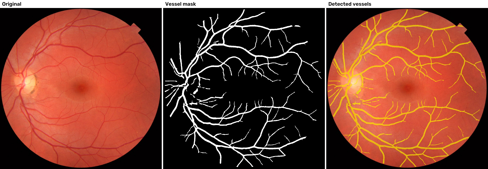
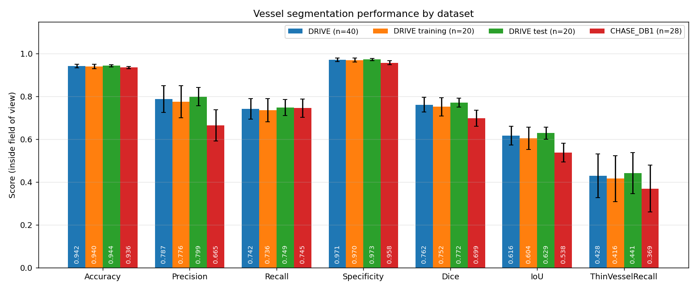

# Retinal Blood Vessel Segmentation — Classical Image Processing

Segments blood vessels in retinal fundus photographs using **only traditional image processing** (no machine learning, no deep learning, no training). The pipeline applies **sharpening first** so that thin vessels are strengthened instead of blurred away, then uses line and Hessian ridge detectors with hysteresis thresholding.

**Authors:** Shaikh Ayaz Hood (241090069), Omkar Pawar (241090056)
Department of Electronics & Telecommunication Engineering, VJTI Mumbai — 2026-27



## Results

Measured on the official DRIVE and CHASE_DB1 downloads, evaluated **inside the field of view (FOV)** only:

| Dataset | Images evaluated | Accuracy | Precision | Recall | Specificity | Dice | IoU |
|---|---|---|---|---|---|---|---|
| DRIVE (training set, with ground truth) | 20 | 0.9399 | 0.7758 | 0.7360 | 0.9700 | 0.7519 | 0.6042 |
| CHASE_DB1 (all images) | 28 | 0.9356 | 0.6646 | 0.7453 | 0.9578 | 0.6987 | 0.5382 |

Full tables with standard deviations: [`results/summary.md`](results/summary.md). Image-wise values: [`results/metrics.csv`](results/metrics.csv).



### Effect of sharpening first

Same pipeline, only the first filtering step changed (`python run.py --mode dataset --ablation`):

| Dataset | First step | Accuracy | Recall | Dice | Thin-vessel recall |
|---|---|---|---|---|---|
| DRIVE | Gaussian blur | 0.9317 | 0.7292 | 0.7254 | 0.3380 |
| DRIVE | None | 0.9376 | 0.7426 | 0.7465 | 0.3860 |
| DRIVE | **Sharpening (final)** | **0.9398** | 0.7360 | **0.7519** | **0.4156** |
| CHASE_DB1 | Gaussian blur | 0.9332 | 0.7760 | 0.6993 | 0.3251 |
| CHASE_DB1 | None | 0.9345 | 0.7724 | 0.7026 | 0.3389 |
| CHASE_DB1 | **Sharpening (final)** | **0.9356** | 0.7453 | 0.6987 | **0.3691** |

*Thin-vessel recall* = fraction of ground-truth pixels on vessels about 3 px wide or less that were detected.

### Honest notes on performance

- **Accuracy is about 94%, not 95–96%.** Around 87% of retina pixels are background, so accuracy is near its ceiling for training-free methods. Dice and IoU show the real segmentation quality.
- **Accuracy is computed inside the FOV only.** Counting the black corners outside the retina would raise the same results to about 96% without the method being any better.
- **DRIVE test images have no official ground truth.** The current official DRIVE download does not include test annotations, so the 20 test images are segmented but **not** scored. If you have `test/1st_manual/` from the original release, put it in place and it is evaluated automatically.
- **The DRIVE training images were used to choose the parameters**, so CHASE_DB1 is the independent result. On the DRIVE test images, using annotations from an unofficial mirror, the same code gave Accuracy 0.9439 and Dice 0.7716.
- **Ground truth is never used during segmentation.** It is only read afterwards to compute metrics.

## Project structure

```
Retina-Vessel-Segmentation/
├── run.py                  # entry point
├── src/
│   ├── main.py             # command-line modes, saving outputs
│   ├── pipeline.py         # the segmentation algorithm
│   ├── evaluation.py       # dataset loading, metrics, CSV, graphs
│   └── utils.py            # image I/O, FOV mask, overlays
├── input/                  # put your own fundus images here
├── datasets/
│   ├── DRIVE/              # download separately (see below)
│   └── CHASE_DB1/          # download separately (see below)
├── outputs/                # step-by-step images (generated, not in git)
├── FINAL_RESULTS/          # final results only: vessel mask + result image
│   ├── custom_images/
│   ├── DRIVE/
│   └── CHASE_DB1/
├── results/                # metrics.csv, summary.csv, summary.md, graphs
├── docs/                   # example pipeline figure for this README
├── requirements.txt
└── .gitignore
```

## Installation

Python 3.9 or newer.

```bash
git clone https://github.com/<your-username>/Retina-Vessel-Segmentation.git
cd Retina-Vessel-Segmentation
pip install -r requirements.txt
```

## Mode A — segment your own image

1. Download any retinal fundus photo (`.jpg`, `.png`, `.tif`, `.bmp`, `.webp`).
2. Copy it into `input/`. File names do not matter; no code change is needed.
3. Run:

```bash
python run.py
```

Add `--show` to open the results in a window during a demonstration.

For every image you get:

| File | Contents |
|---|---|
| `FINAL_RESULTS/custom_images/<name>_vessel_mask.png` | Clean binary mask: white = vessel, black = background |
| `FINAL_RESULTS/custom_images/<name>_result.jpg` | Original, vessel mask and vessels highlighted in yellow, side by side |
| `outputs/custom_images/<name>/` | Every intermediate stage plus `pipeline_overview.jpg` |

No accuracy is shown for these images, because there is no ground truth to compare with. The console prints only the percentage of the retina covered by detected vessels.

## Mode B — evaluate on DRIVE and CHASE_DB1

```bash
python run.py --mode dataset                     # both datasets
python run.py --mode dataset --dataset DRIVE     # DRIVE only
python run.py --mode dataset --dataset CHASE_DB1 # CHASE_DB1 only
python run.py --mode all                         # custom images + both datasets
```

The console prints metrics for every image, then a summary per dataset. Outputs:

| File | Contents |
|---|---|
| `results/DRIVE_metrics.csv`, `results/CHASE_DB1_metrics.csv` | Image-wise metrics, including which images were evaluated |
| `results/metrics.csv` | All evaluated datasets in one file |
| `results/summary.csv`, `results/summary.md` | Mean ± standard deviation per dataset and per DRIVE split |
| `results/performance_summary.png` | Dataset comparison chart |
| `results/<dataset>_per_image.png` | Image-wise Accuracy, Dice and IoU |
| `results/ablation.csv`, `results/ablation.png` | Only with `--ablation` |
| `FINAL_RESULTS/<dataset>/` | Mask and result image for every image |
| `outputs/<dataset>/<image>/` | Stages, error map (white = correct, red = false vessel, blue = missed) and overview figure |

### Options

| Option | Meaning |
|---|---|
| `--mode custom\|dataset\|all` | What to run (default `custom`) |
| `--dataset DRIVE\|CHASE_DB1\|all` | Which dataset in dataset mode (default `all`) |
| `--input <folder>` | Use another folder for custom images |
| `--datasets-root <folder>` | Datasets stored somewhere else |
| `--no-details` | Skip the step-by-step images in `outputs/` (faster) |
| `--ablation` | Also compare sharpening against Gaussian blur and no pre-filter |
| `--show` | Display the custom-image results in a window |

Run time on a laptop: about 1 s per DRIVE image and 2 s per CHASE_DB1 image, including the saved figures. `--ablation` roughly triples this.

## Downloading the datasets

The datasets are not included in this repository. Download them and arrange them as shown.

### DRIVE

- Page: <https://drive.grand-challenge.org/DRIVE/> (a free grand-challenge account is required)
- Download `training.zip` and `test.zip` and extract both into `datasets/DRIVE/`:

```
datasets/DRIVE/
├── training/
│   ├── images/       21_training.tif ... 40_training.tif
│   ├── 1st_manual/   21_manual1.gif ... 40_manual1.gif   <- ground truth
│   └── mask/         21_training_mask.gif ...             <- FOV masks
└── test/
    ├── images/       01_test.tif ... 20_test.tif
    ├── mask/         01_test_mask.gif ...
    └── 1st_manual/   only if you have it (not in the official download)
```

- 40 images, 565 × 584 pixels. Training ground truth comes from the first observer (`1st_manual`). FOV masks are provided for all 40 images.

### CHASE_DB1

- Direct zip: <https://staffnet.kingston.ac.uk/~ku15565/CHASE_DB1/assets/CHASEDB1.zip>
- Dataset record: <https://researchdata.kingston.ac.uk/96/>
- Extract all files into `datasets/CHASE_DB1/`. The zip is flat, with 84 files:

```
datasets/CHASE_DB1/
├── Image_01L.jpg
├── Image_01L_1stHO.png   <- ground truth (first human observer, used)
├── Image_01L_2ndHO.png   <- second observer (not used)
└── ... (28 images × 3 files)
```

- 28 images, 999 × 960 pixels, from both eyes of 14 children. No FOV masks are provided, so the code estimates one from the image itself; the CSV marks this as `estimated`.

## How the pipeline works

1. **FOV mask** — the official DRIVE mask, or an estimate from the red channel for other images.
2. **Green channel + border padding** — vessels have the best contrast in green. The black corners are filled with nearby retina values so filters do not see a false edge.
3. **Unsharp-mask sharpening** — `g + 1.0 × (g − GaussianBlur(g, σ=2))`. This increases the contrast of narrow structures such as thin vessels and leaves wide vessels almost unchanged.
4. **CLAHE** — local contrast equalisation (8 × 8 tiles, clip limit 2.0) to correct uneven illumination.
5. **Background removal** — a 25 × 25 median filter estimates the background. Subtracting it makes vessels bright and removes the bright optic disc.
6. **Vessel detection**
   - **Multiscale line detector** — best average along a line at 12 angles, for lengths 3–15 px.
   - **Hessian ridge detector** — second derivatives at σ = 1, 1.5, 2 and 3. Small σ finds thin vessels.
7. **Fusion** — each response is normalised (z-score) and combined: 0.4 darkness + 0.2 line + 0.4 Hessian.
8. **Hysteresis thresholding** — the top 10% of retina pixels are sure vessels. Pixels in the top 13% are kept only if they connect to a sure vessel, so faint thin branches survive and isolated noise does not.
9. **Small-object removal** — connected components under 30 px are removed. No morphological opening is used, because opening erases 1–2 px vessels.

Sizes are defined for DRIVE (FOV about 540 px wide) and scaled automatically to each image. Very large photos are processed at a reduced size. Parameters were chosen on DRIVE training images and are fixed in `src/pipeline.py`.

### Metrics

TP, TN, FP and FN are counted pixel by pixel **inside the FOV**:

| Metric | Formula |
|---|---|
| Accuracy | (TP + TN) / (TP + TN + FP + FN) |
| Precision | TP / (TP + FP) |
| Recall (Sensitivity) | TP / (TP + FN) |
| Specificity | TN / (TN + FP) |
| Dice | 2TP / (2TP + FP + FN) |
| IoU | TP / (TP + FP + FN) |


## Demonstration checklist

1. Put a downloaded fundus image in `input/` and run `python run.py --show`.
2. Open `FINAL_RESULTS/custom_images/` to show the mask and the highlighted vessels.
3. Open `outputs/custom_images/<name>/pipeline_overview.jpg` to walk through each step.
4. Run `python run.py --mode dataset --dataset DRIVE`, then `--dataset CHASE_DB1`, and show the printed image-wise and overall metrics.
5. Show `results/summary.md`, `results/performance_summary.png` and an error map from `outputs/`.

## Troubleshooting

- **No images found** — check that the folder names match the layouts above (for example `datasets/DRIVE/training/images`).
- **DRIVE masks read as empty on old OpenCV** — OpenCV older than 4.7 cannot read GIF files; the code falls back to Pillow automatically.
- **A file in `input/` is skipped** — it is not a readable image; the run continues with the rest.

## Credits

- J. Staal et al., "Ridge-based vessel segmentation in color images of the retina," *IEEE Trans. Medical Imaging*, 23(4), 2004 — DRIVE.
- M. M. Fraz et al., "An ensemble classification-based approach applied to retinal blood vessel segmentation," *IEEE Trans. Biomedical Engineering*, 59(9), 2012 — CHASE_DB1.
- U. T. V. Nguyen et al., "An effective retinal blood vessel segmentation method using multi-scale line detection," *Pattern Recognition*, 46(3), 2013 — line detector.
- Sample image `input/sample_fundus.jpg`: M. Häggström, "Fundus photograph of normal left eye," Wikimedia Commons, CC0 (public domain).
