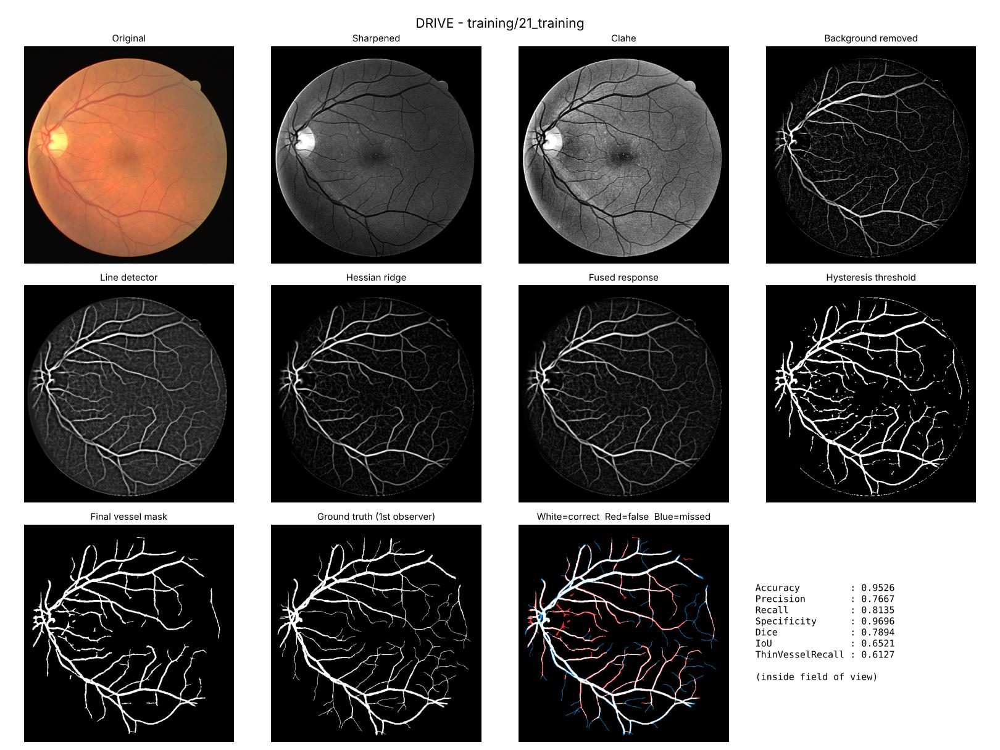

# Retinal Blood Vessel Segmentation

Automatic segmentation of blood vessels in retinal fundus photographs using **classical image processing only** — no machine learning, no deep learning, no training data. The pipeline applies **sharpening first** so that thin capillaries are strengthened rather than blurred away, then detects vessels with a multiscale line detector and a Hessian ridge detector, and produces a clean binary vessel mask with hysteresis thresholding.

**Authors:** Shaikh Ayaz Hood (241090069), Omkar Pawar (241090056)
**Guide:** Prof. Gajanan Galshetwar
Department of Electronics & Telecommunication Engineering, VJTI Mumbai — Image Processing (R5EL3103T), 2026–27


## Highlights

- Works on **any fundus photograph** — drop it into `input/` and run one command.
- Preserves **1–2 pixel capillaries** by sharpening before any other operation.
- Evaluated on two public datasets: **DRIVE (40 images)** and **CHASE_DB1 (28 images)**.
- Fully explainable: every intermediate stage is saved and can be inspected.
- About **1 second per image** on a normal laptop CPU.

## Results

All metrics are computed **inside the field of view (FOV)**, i.e. only on the circular retina, not on the black corners.

| Dataset | Images | Accuracy | Precision | Recall | Specificity | Dice | IoU |
|---|---|---|---|---|---|---|---|
| DRIVE | 40 | 0.942 | 0.788 | 0.742 | 0.971 | 0.762 | 0.616 |
| CHASE_DB1 | 28 | 0.936 | 0.665 | 0.745 | 0.958 | 0.699 | 0.538 |

- Parameters were chosen on the 20 DRIVE training images only and then frozen. On the 20 unseen DRIVE test images the method reaches **Accuracy 0.944, Dice 0.772**, and CHASE_DB1 was never used for tuning.
- Ground truth is used **only** to score the final mask, never during segmentation.
- Mean ± standard deviation: [`results/summary.md`](results/summary.md). Image-wise values: [`results/metrics.csv`](results/metrics.csv).


## How the pipeline works



| Step | Operation | What it does |
|---|---|---|
| 1 | Green channel | Vessels look darkest and clearest in the green colour layer. The black corners are filled with nearby retina values so filters do not see a false edge. |
| 2 | Sharpening (unsharp mask) | `g + 1.0 × (g − GaussianBlur(g, σ = 2))` adds fine detail back, so thin vessels become darker instead of fading. |
| 3 | CLAHE | Local contrast equalisation (8 × 8 tiles, clip 2.0) evens out the bright centre and dark edges. |
| 4 | Background removal | A 25 × 25 median filter estimates the background; subtracting it turns vessels into bright lines and removes the optic disc. |
| 5 | Line detector | Averages along short lines at 12 angles (3–15 px). A vessel has one strong direction; noise does not. |
| 6 | Hessian ridge | Second-derivative ridge strength at σ = 1, 1.5, 2, 3 px. The smallest scale catches 1–2 px capillaries. |
| 7 | Fusion | Each map is z-score normalised and combined: 0.4 darkness + 0.2 line + 0.4 Hessian. |
| 8 | Hysteresis threshold | Top 10% of retina pixels are sure vessels; pixels in the top 13% are kept only if connected to them. |
| 9 | Final mask | Blobs under 30 px are removed (no morphological opening, which would erase thin vessels). |

**Why sharpening first?** Averaged over 31,059 thin-vessel crossings in DRIVE, a thin vessel is 4.9 grey levels darker than its background. Smoothing reduces this to 3.5, while sharpening raises it to **7.7** — 2.2× more visible to every later step. Noise is handled afterwards by the direction-aware line, Hessian and hysteresis steps.

All window sizes are defined for a DRIVE-sized retina (≈540 px wide) and scale automatically with each image. Very large photos are processed at reduced size. Parameters live in `src/pipeline.py`.

## Project structure

```
retinal-vessel-segmentation/
├── run.py                  # entry point
├── src/
│   ├── main.py             # command-line modes, saving outputs
│   ├── pipeline.py         # the segmentation algorithm
│   ├── evaluation.py       # dataset loading, metrics, CSV, graphs
│   └── utils.py            # image I/O, FOV mask, overlays
├── input/                  # put your own fundus images here
├── datasets/
│   ├── DRIVE/              # download separately (see below)
│   └── CHASE_DB1/          # download separately (see below)
├── outputs/                # step-by-step images (generated, not in git)
├── FINAL_RESULTS/          # final vessel masks and result images only
│   ├── custom_images/
│   ├── DRIVE/
│   └── CHASE_DB1/
├── results/                # metrics.csv, summary.csv, summary.md, graphs
├── docs/                   # figures used in this README
├── requirements.txt
└── .gitignore
```

## Installation

Python 3.9 or newer.

```bash
git clone https://github.com/HoodShaikh/retinal-vessel-segmentation.git
cd retinal-vessel-segmentation
pip install -r requirements.txt
```

## Mode A — segment your own image

1. Download any retinal fundus photo (`.jpg`, `.png`, `.tif`, `.bmp`, `.webp`).
2. Copy it into `input/`. File names do not matter and no code change is needed.
3. Run:

```bash
python run.py
```

Add `--show` to open the results in a window during a demonstration.

| Output | Contents |
|---|---|
| `FINAL_RESULTS/custom_images/<name>_vessel_mask.png` | Binary mask: white = vessel, black = background |
| `FINAL_RESULTS/custom_images/<name>_result.jpg` | Original, mask and highlighted vessels side by side |
| `outputs/custom_images/<name>/` | Every intermediate stage plus `pipeline_overview.jpg` |

No accuracy is shown for these images because there is no ground truth to compare with; the console prints the percentage of the retina covered by detected vessels.

## Mode B — evaluate on DRIVE and CHASE_DB1

```bash
python run.py --mode dataset                      # both datasets
python run.py --mode dataset --dataset DRIVE      # DRIVE only
python run.py --mode dataset --dataset CHASE_DB1  # CHASE_DB1 only
python run.py --mode all                          # custom images + both datasets
```

The console prints metrics for every image, then a summary per dataset.

| Output | Contents |
|---|---|
| `results/DRIVE_metrics.csv`, `results/CHASE_DB1_metrics.csv` | Image-wise metrics and whether each image was evaluated |
| `results/metrics.csv` | All datasets in one file |
| `results/summary.csv`, `results/summary.md` | Mean ± standard deviation per dataset and DRIVE split |
| `results/performance_summary.png` | Dataset comparison chart |
| `results/<dataset>_per_image.png` | Image-wise Accuracy, Dice and IoU |
| `FINAL_RESULTS/<dataset>/` | Mask and result image for every image |
| `outputs/<dataset>/<image>/` | All stages, error map (white = correct, red = false, blue = missed) and overview figure |

### Options

| Option | Meaning |
|---|---|
| `--mode custom\|dataset\|all` | What to run (default `custom`) |
| `--dataset DRIVE\|CHASE_DB1\|all` | Which dataset in dataset mode (default `all`) |
| `--input <folder>` | Use another folder for custom images |
| `--datasets-root <folder>` | Datasets stored somewhere else |
| `--no-details` | Skip the step-by-step images in `outputs/` (faster) |
| `--show` | Display the custom-image results in a window |

## Datasets

The datasets are not included in this repository. Download them and arrange them as shown below. Any image without a ground-truth file is still segmented, but is marked *not evaluated* instead of being given a score.

### DRIVE

- Page: <https://drive.grand-challenge.org/DRIVE/> (free account required)
- Extract `training.zip` and `test.zip` into `datasets/DRIVE/`:

```
datasets/DRIVE/
├── training/
│   ├── images/       21_training.tif ... 40_training.tif
│   ├── 1st_manual/   21_manual1.gif ... 40_manual1.gif   <- ground truth
│   └── mask/         21_training_mask.gif ...             <- FOV masks
└── test/
    ├── images/       01_test.tif ... 20_test.tif
    ├── 1st_manual/   01_manual1.gif ... 20_manual1.gif   <- ground truth
    └── mask/         01_test_mask.gif ...
```

- 40 images, 565 × 584 px, first-observer annotations, FOV masks provided.
- Some copies of the official download do not include `test/1st_manual`; the original-release test annotations are available in public research mirrors. Without them, the 20 test images are segmented but not scored.

### CHASE_DB1

- Direct zip: <https://staffnet.kingston.ac.uk/~ku15565/CHASE_DB1/assets/CHASEDB1.zip>
- Dataset record: <https://researchdata.kingston.ac.uk/96/>
- Extract all 84 files directly into `datasets/CHASE_DB1/`:

```
datasets/CHASE_DB1/
├── Image_01L.jpg
├── Image_01L_1stHO.png   <- ground truth (first observer, used)
├── Image_01L_2ndHO.png   <- second observer (not used)
└── ... (28 images × 3 files)
```

- 28 images, 999 × 960 px, both eyes of 14 children. No FOV masks are provided, so one is estimated from each image (marked `estimated` in the CSV).

## Evaluation metrics

TP, TN, FP and FN are counted pixel by pixel inside the FOV.

| Metric | Formula |
|---|---|
| Accuracy | (TP + TN) / (TP + TN + FP + FN) |
| Precision | TP / (TP + FP) |
| Recall (Sensitivity) | TP / (TP + FN) |
| Specificity | TN / (TN + FP) |
| Dice | 2TP / (2TP + FP + FN) |
| IoU | TP / (TP + FP + FN) |

Vessels cover only about 10–13% of the retina, so accuracy is dominated by background pixels; Dice and IoU are the better measures of segmentation quality.

## Troubleshooting

- **No images found** — check the folder names against the layouts above (for example `datasets/DRIVE/training/images`).
- **DRIVE masks read as empty** — OpenCV older than 4.7 cannot read GIF files; the code falls back to Pillow automatically.
- **A file in `input/` is skipped** — it is not a readable image; the run continues with the rest.

## References

1. J. Staal et al., "Ridge-based vessel segmentation in color images of the retina," *IEEE Trans. Medical Imaging*, 23(4), 2004 — DRIVE.
2. M. M. Fraz et al., "An ensemble classification-based approach applied to retinal blood vessel segmentation," *IEEE Trans. Biomedical Engineering*, 59(9), 2012 — CHASE_DB1.
3. U. T. V. Nguyen et al., "An effective retinal blood vessel segmentation method using multi-scale line detection," *Pattern Recognition*, 46(3), 2013.
4. A. F. Frangi et al., "Multiscale vessel enhancement filtering," *MICCAI*, 1998.
5. K. Zuiderveld, "Contrast limited adaptive histogram equalization," *Graphics Gems IV*, 1994.
6. R. C. Gonzalez and R. E. Woods, *Digital Image Processing*, 4th ed., Pearson, 2018.

Sample image `input/sample_fundus.jpg`: M. Häggström, "Fundus photograph of normal left eye," Wikimedia Commons, CC0 (public domain).
